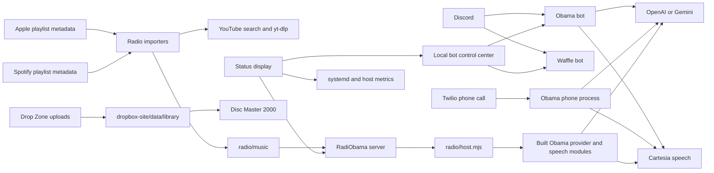

# the great texts of obaffle theory conceived in the 6th year of the 2nd decade of the 21st century

Obaffle is a collection of programs for one home server. It is one Git repository, but its directories are mostly independent applications. Two Discord bots can be run together through a local control center; a radio station reuses one bot's AI and speech code; a file gallery provides a local library that a disc burner can browse. A YouTube downloader, VPN installer, and status display round out the system.

This is the system-level guide. Each application's own README contains detailed setup and command instructions. Paths and service units in this repository are written for the current Linux host; change them when deploying elsewhere. No single command installs or starts every component.

## Contents

1. [The map](#the-map)
2. [How everything connects](#how-everything-connects)
3. [Obama: the conversation bot](#obama-the-conversation-bot)
4. [Waffle: the music bot](#waffle-the-music-bot)
5. [The bot control center](#the-bot-control-center)
6. [RadiObama: the web radio station](#radiobama-the-web-radio-station)
7. [TubeDrop: the YouTube downloader](#tubedrop-the-youtube-downloader)
8. [Drop Zone: the file gallery](#drop-zone-the-file-gallery)
9. [Disc Master 2000: the optical disc tool](#disc-master-2000-the-optical-disc-tool)
10. [The home VPN installer](#the-home-vpn-installer)
11. [The status display](#the-status-display)
12. [Gather Round Trivia](#gather-round-trivia)
13. [Running, data, and maintenance](#running-data-and-maintenance)

## The map

| Path | Purpose | Main entry point | Local interface |
| --- | --- | --- | --- |
| [`Obama/`](Obama/README.md) | Discord conversation, voice, image, and phone bot | `npm start`, `npm run dev`, or `npm run phone:host` | Discord; dashboard on `127.0.0.1:3000`; phone on `127.0.0.1:3002` by default |
| [`Waffle/`](Waffle/waffle/README.md) | Discord music bot | `.venv/bin/python -m waffle.bot` | Discord slash commands |
| [`Obama/control-center/`](Obama/control-center/README.md) | Starts and controls both bots | `cd Obama && npm run bots` | `127.0.0.1:3001` |
| [`radio/`](radio/README.md) | Continuous shared radio stream, requests, AI host, admin panel, playlist import | `python3 radio/server.py` | `127.0.0.1:3004` |
| [`youtube-downloader/`](youtube-downloader/README.md) | Web UI for MP3 and MP4 downloads | `python3 app.py` | `127.0.0.1:8765` |
| [`dropbox-site/`](dropbox-site/README.md) | Private upload gallery and share links | Gunicorn serving `app:app` | `127.0.0.1:3005` |
| [`disc-burner/`](disc-burner/README.md) | Terminal tool to inspect, burn, and back up data discs | `python3 disc-burner/disc_burner.py` | Terminal and optical drive |
| [`vpn-setup/`](vpn-setup/README.md) | Installs an OpenVPN TCP server and Mac client profile | `sudo bash vpn-setup/install-openvpn-home.sh` | TCP 443 by default |
| [`scripts/`](scripts/status-report.py) | Reads local service and host status | `python3 scripts/status-report.py` | Terminal |
| [`trivia/`](trivia/README.md) | Live host-and-phone trivia game with preset and Gemini questions | `trivia.service` or `npm start` from `trivia/` | `127.0.0.1:3006` by default |

The top-level `radio-education-import.service` and `.timer` are systemd user units for the Education music pool. Other service units live beside the programs they launch. The top-level `gitignore` is a support file, not an executable.

### Requirements by component

| Component | Runtime and external tools | Accounts or services |
| --- | --- | --- |
| Obama | Node.js 22.12+, npm; dependencies in `Obama/package.json` | Discord, configured OpenAI or Gemini, Cartesia; Twilio and a public HTTPS/WebSocket route for phone |
| Waffle | Python 3.11+, FFmpeg, yt-dlp, Deno 2.3+ or Node 22+ | Discord and YouTube access |
| Control center | Obama's Node installation and Waffle's Python environment | The two configured Discord bots |
| Radio | Python 3, FFmpeg/ffprobe; Node and built Obama output for AI host; yt-dlp for imports | AI and Cartesia for host segments; public playlist metadata for imports |
| TubeDrop | Python 3.10+, yt-dlp, FFmpeg | YouTube access |
| Drop Zone | Python, Flask, Gunicorn; FFmpeg for large GIF previews | None for local use |
| Disc Master 2000 | Python 3, `xorriso`, Linux optical drive access | None |
| VPN installer | Ubuntu, root access, OpenVPN, OpenSSL, iptables/ip6tables | Router port forwarding for outside access |
| Gather Round Trivia | Node.js 22+, no package dependencies | Optional Gemini API key for AI questions |

Obama and Waffle have separate dependency environments and separate Discord tokens. The component READMEs are the best place for installation details and version-specific troubleshooting.

## How everything connects



These arrows show actual code or file dependencies, not a unified installer. Waffle and TubeDrop both use yt-dlp, but neither hands its queue or downloads to the other. The radio importers maintain their own music library. The VPN server offers a way to reach the home network; the web apps do not depend on it. Public web access, where configured, comes through Cloudflare Tunnel routes to local services.

### Paths where components meet

- `Obama/control-center/server.mjs` starts `Obama/scripts/run.mjs` and `Waffle/waffle/bot.py` as managed child processes. It does not own separately launched copies.
- `radio/host.mjs` loads compiled modules from `Obama/dist/src/` and reads `Obama/.env`. Build Obama before using AI host segments. The radio server calls the host as a separate Node process.
- `radio-import.service` and `radio-education-import.service` use `Waffle/.venv/bin/python` for the radio import scripts. They share a Python environment, not Waffle's Discord player or queue.
- `disc-burner/disc_burner.py` offers a shortcut to `dropbox-site/data/library`. Drop Zone creates local paths there for uploaded originals. Moving or renaming a file can change that path, so select files after organizing them.
- `scripts/status-report.py` reads the control center's `/api/state`, Obama's dashboard `/api/stats`, the radio's `/status`, systemd service state, and host metrics. It observes services; it does not start them.

## Obama: the conversation bot

[`Obama/README.md`](Obama/README.md) is the detailed operator and command guide. Obama is a TypeScript Discord bot with text replies, voice conversation, image generation and understanding, optional ambient channel conversation, direct messages, a local dashboard, and a separate incoming-phone process. The ordinary Discord bot needs a Discord token, one configured chat provider, one configured speech-to-text provider, and Cartesia for speech. Chat and transcription providers can be OpenAI or Gemini independently; image generation has its own provider choice.

### Discord text flow

`src/index.ts` loads configuration, starts the dashboard and a local command socket, and starts `ObamaBot` from `src/bot.ts`. On `messageCreate`, the bot parses case-insensitive `Obama...` commands, handles a direct bot mention, or considers configured conversation mode. Commands include `ObamaText`, `ObamaSpeak`, `ObamaImage`, `ObamaJoin`, `ObamaLeave`, voice and instruction settings, memory controls, status, direct messages, and restart. The complete list and permissions are in the [Obama command guide](Obama/README.md#commands). Short aliases are available per server when enabled.

`src/conversation-service.ts` serializes requests by server and channel, assembles instructions and optional recent memory, reads eligible public links, and sends the prompt to the selected provider. `src/memory.ts` keeps bounded conversation history in RAM by channel. The per-server `data/guild-settings.json` stores durable preferences such as voice aliases, instructions, memory preference, shortcuts, and conversation channel settings; it does not store conversation history. Some flows, including image questions, status, and ambient conversation, do not update that memory.

| Source module | Responsibility |
| --- | --- |
| `src/config.ts`, `src/doctor.ts` | Parse and validate environment settings; report configuration problems without printing secrets |
| `src/commands.ts` | Parse text commands, shortcuts, bot mentions, wake phrases, and voice stop requests |
| `src/bot.ts` | Discord events, command permissions and replies, provider calls and voice coordination |
| `src/providers/` | OpenAI and Gemini chat and transcription adapters; provider selection |
| `src/cartesia.ts`, `src/audio.ts`, `src/speech-options.ts` | Speech synthesis, PCM/WAV conversion, speech model and emotion settings |
| `src/voice-manager.ts`, `src/live-captions.ts` | Discord voice connections, utterance capture and playback, optional caption messages |
| `src/conversation-mode.ts`, `src/conversation-service.ts`, `src/memory.ts` | Ambient chat selection, reply construction, bounded in-memory context |
| `src/image-understanding.ts`, `src/link-context.ts` | Attachment validation and bounded public-page/image reading |
| `src/settings-store.ts`, `src/phone-settings.ts` | Durable guild and phone settings |
| `src/dm-broadcast.ts`, `src/global-status.ts` | Owner-controlled broadcasts and cross-server status report |
| `src/dashboard.ts`, `src/dashboard-page.ts`, `src/logger.ts` | Local stats page and console telemetry |
| `src/phone.ts`, `scripts/phone-host.mjs` | Incoming Twilio bridge and its tunnel launcher |

### Discord voice flow

`ObamaJoin` creates one voice session per Discord server. The bot receives individual users' Opus audio, decodes a completed utterance, rejects audio below the configured duration or loudness thresholds, and sends accepted audio to the selected speech-to-text provider. The transcript is tested for the wake word (default `Obama`) or an open follow-up window. A qualifying prompt goes through the chat provider; Cartesia synthesizes the reply; the bot plays PCM through Discord. `Obama, stop` can interrupt a playing or pending reply. Because wake matching happens **after** transcription, completed speech segments from people in a joined channel can reach the speech provider even when they did not address the bot. Captions, when enabled in code, are Discord messages and persist separately from RAM memory.

Text mentions with images use the configured chat model's vision input. `ObamaImage` uses the separately selected image model and can recreate an attached image. Public links in prompts can be fetched with size, time, redirect, and network-address limits. Provider output and transcripts are logged at normal verbosity; the process itself does not write an audio archive.

### Dashboard, restart, and phone

The bot dashboard is loopback-only and normally listens on port 3000. The supervisor in `scripts/run.mjs` lets `ObamaRestart` replace the bot process; direct execution of `dist/src/index.js` does not provide that restart behavior. On startup, the bot also creates a local `aiden` command socket under `~/.local/share/obama/aiden.sock`; messages sent through it go to the Discord channel IDs configured in `src/index.ts`.

The phone process is separate from the Discord bot. `src/phone.ts` accepts a secret-path Twilio webhook and WebSocket media stream, converts 8 kHz μ-law audio for transcription, maintains a per-call in-memory conversation, and sends Cartesia audio back. Calls are inbound only and limited to 15 minutes. The Discord application owner can change phone greeting, personality, and voice through `ObamaPhone`; new calls read `data/phone-settings.json`. `phone-host.service` runs `npm run phone:host`, which builds the TypeScript app and launches the phone server with the tunnel.

**Current-code disclosure discrepancy:** the phone README describes an AI disclosure greeting, but the default greeting in `src/phone-settings.ts` says “This is Barack Obama speaking,” and that file's phone instructions tell the model to present itself as a human. `src/phone.ts` adds an AI disclosure only when a *custom* greeting differs from the default. Treat the source behavior as authoritative until those files are corrected; do not assume the default call identifies itself as AI.

```sh
cd Obama
npm install
# Configure Obama/.env with your own private credentials.
npm run doctor
npm run build
npm start
```

Use `npm run dev` for source watching, `npm run phone:host` for phone hosting, `npm test` for offline tests and control-center tests, and `npm run typecheck` for TypeScript validation. [`Obama/livekit-phone-not-used/`](Obama/livekit-phone-not-used/README.md) is an archived alternate phone experiment, not part of the active Twilio route.

## Waffle: the music bot

[`Waffle/waffle/README.md`](Waffle/waffle/README.md) covers installation, slash commands, and troubleshooting. Waffle is an independent Python Discord application. It accepts `/play` YouTube searches, video URLs, and playlists; `/search` offers a private choice from up to five results. Queue, pause, skip, stop, shuffle, loop, volume, equalizer, and preset effects are controlled by slash commands. It has one `Player` per Discord server and normally leaves after the queue has been empty for 180 seconds or when all human listeners depart.

`waffle/bot.py` creates the Discord client and command tree, validates the user's voice channel, and handles slash commands. `waffle/audio.py` validates YouTube targets, searches or extracts tracks with yt-dlp, resolves a fresh stream URL when playback starts, and builds FFmpeg filters. `waffle/player.py` owns a serialized playback task and queue for each server; FFmpeg produces Opus audio for Discord. A preset and three-band EQ can be combined, and settings take effect when the next track starts. Queue and effects live in RAM and disappear after disconnect or restart.

```sh
cd Waffle
python3 -m venv .venv
.venv/bin/python -m pip install -e '.[dev]'
# Configure Waffle/.env with the Discord token.
.venv/bin/python -m waffle.bot
.venv/bin/python -m pytest -q
```

The tests in `Waffle/tests/` exercise parsing, queue behavior, errors, and FFmpeg audio behavior without connecting to Discord. FFmpeg and a compatible JavaScript runtime must also be available for actual YouTube playback.

## The bot control center

[`Obama/control-center/README.md`](Obama/control-center/README.md) documents the shared launcher. `cd Obama && npm run bots` serves a loopback page on port 3001 and starts both bots automatically. `server.mjs` defines paths, ports, HTTP routes, server-sent event updates, and access checks. `manager.mjs` owns child process groups, start/stop/restart operations, recent logs, and process status. The page can embed Obama's separate dashboard on port 3000 when it is ready.

The control center retains recent log lines and Gemini API call metadata in memory for the running launcher, then loses them when it exits. It does not replay historic provider calls. It only controls children it launched. A crashed child stays stopped until Start is clicked; the other bot and control page can remain available. Stop and restart interrupt in-flight requests and Waffle music. Its API is local and uses host/origin checks and a per-launch action token. Run `npm run test:control` from `Obama/` to verify the controller without Discord credentials.

## RadiObama: the web radio station

[`radio/README.md`](radio/README.md) has the full operator guide. `radio/server.py` is a Python `ThreadingHTTPServer` plus a station worker. It discovers local audio under `radio/music/`, creates one continuous 128 kb/s MP3 program, and broadcasts it to all listeners. A second FFmpeg worker converts that program to HLS segments for browsers. The public page and request list are shared: a request goes next when the current track ends, with a 20-request queue limit. The station chooses other songs from a recent-rotation-aware pool. It notices newly added files during operation.

`radio/schedule.json` selects `morning` (06:00–12:00), `daytime` (12:00–18:00), and `night` (18:00–06:00) folders in local time. If a scheduled folder has no tracks, the station falls back to the available pool. An `education` subfolder is a separate selectable pool; all other music folders belong to Main. Admin settings in `radio/settings.json` persist the active pool, disabled tracks, announcement switch, and selected voice. Files in `radio/announcements/` can play between songs about every 30 minutes.

Before a song, `radio/server.py` can call `radio/host.mjs` with previous/next-song metadata. The Node script uses Obama's compiled provider and Cartesia adapters to write and synthesize an AI host segment. Styles include music, listener, clock, weather, and occasional artist history. It can get National Weather Service forecasts and a Wikipedia artist extract. The station overlaps the next song's beginning with the end of a host segment; failure to make a callout does not stop music. Host previews and live callouts consume provider credits.

The HTTP service includes `/` for the player, `/status` for station state, `/stream.mp3` for direct listening, `/hls/live.m3u8` for HLS, public song search/request endpoints, and a password-protected `/admin` panel. The panel can skip a song, switch pools, enable or disable tracks and announcements, set the host voice, inspect status, and generate off-air previews. `radio/admin.env` supplies the admin password to the service and is private. Session cookies and CSRF/origin checks protect admin actions; public song requests remain open to listeners.

### Playlist ingestion

- `radio/import_apple.py` reads public Apple Music playlist metadata, searches YouTube, scores title/artist/duration matches, and writes review data to `radio/apple-matches.json`. With `--download`, ready matches at the default score threshold of 85 go to `radio/music/apple-import/`. `radio/downloaded.txt` prevents repeated downloads.
- `radio/sync_playlists.py` runs the Apple importer for each URL in `radio/playlists.txt`. `radio/radio-import.timer` schedules its service daily at 04:00 local time.
- `radio/import_spotify.py` reads public Spotify playlist metadata, matches YouTube candidates, and downloads high-confidence MP3s into `radio/music/education/`. `radio/spotify-matches.json` and `radio/spotify-import-status.json` let interrupted work resume. The top-level `radio-education-import.timer` restarts the matching service after inactivity.
- Apple Music and Spotify provide metadata, not audio. The actual downloaded media comes from matching YouTube results. A match score is a review aid, not proof that a recording is correct or that streaming rights exist.

Run `python3 radio/server.py` from the repository root for a local station. The included systemd user service keeps it running across logouts. See the [radio guide](radio/README.md) for the admin panel, public tunnel route, importer commands, and pool controls.

## TubeDrop: the YouTube downloader

[`youtube-downloader/README.md`](youtube-downloader/README.md) explains setup and remote access. `app.py` is a loopback-only Python HTTP service on port 8765 by default. The browser submits a YouTube video or playlist URL, desired MP3 or MP4 format, and quality. The server validates the host and arguments, starts a yt-dlp/FFmpeg process for the job, and reports progress through `/api/jobs`. Jobs can be cancelled; finished files can be downloaded singly or as a ZIP. `/api/files` lists previously downloaded MP3/MP4 files.

The default output is `~/Downloads/YouTube`, grouped by playlist title; `YTDL_OUTPUT` changes it. Existing files are not overwritten. Job state, logs, and sign-in sessions live in RAM, while downloaded files remain on disk. If `YTDL_PASSWORD` is set, the app requires a password and gives a seven-day session cookie. The supplied `tubedrop.service` reads private `service.env`. `tunnel.py` can launch the app with a temporary Cloudflare Tunnel; the stable deployment uses a published route to the same local port. This application does not feed Waffle's queue or the radio library automatically.

## Drop Zone: the file gallery

[`dropbox-site/README.md`](dropbox-site/README.md) is the user and deployment guide. The folder name is historical: this is a local Flask application, not an integration with the Dropbox service. It requires `DROP_PASSWORD` and `DROP_SECRET`, and Gunicorn normally serves it on `127.0.0.1:3005`. A login is required to upload, browse, organize, rename, move, or delete files. The UI uses 8 MiB upload chunks for files up to 2 GiB. The older form upload remains for smaller files.

`app.py` stores metadata and folder structure in `data/files.sqlite3`, originals in `data/files/`, unfinished chunks in `data/parts/`, generated GIF previews in `data/previews/`, and local original-file paths in `data/library/`. Old incomplete uploads are cleaned on startup. A tokenized `/f/<token>` link downloads the original and survives a rename or folder move. Media and filename URLs can display images, audio, video, and PDFs directly; filename paths can change when the file or folder name changes. Anyone who has a working file URL can access it, so login protection applies to managing files rather than every shared link.

The browser's **Copy internal file location** produces a server-local path under `data/library/`; this is the integration point for Disc Master 2000. Back up the entire `data/` directory to preserve both file bytes and link identity. The included `drop-zone.service` starts Gunicorn with the private `.env` file.

## Disc Master 2000: the optical disc tool

[`disc-burner/README.md`](disc-burner/README.md) lists the keyboard controls. `disc_burner.py` is a curses interface for Linux optical drives. It discovers `/dev/sr*` devices, browses files and folders, builds a burn list, invokes `xorriso` to create a temporary ISO, checks reported capacity, inspects the disc again, and burns after an explicit confirmation. Written rewritable media requires an `ERASE` confirmation; write-once or read-only media is blocked. The app can inspect a data disc, perform a full read-only surface scan, eject or close the tray, and back up a readable data disc to an ISO.

`media.py` parses `xorriso` media and catalogue reports. `backup.py` reads a disc, checks for read errors, verifies that the resulting ISO's file list matches the disc, and publishes a finished backup without overwriting an existing file. Failed or cancelled backups are removed. Audio CDs and bootable-disc creation are outside this tool's scope. The file browser includes a shortcut to Drop Zone's `data/library/`; the tool still works with other readable filesystem paths. Run `python3 disc-burner/disc_burner.py --check` to check dependencies before opening the interface. `test_disc_burner.py` covers the non-interactive media and backup logic.

## The home VPN installer

[`vpn-setup/README.md`](vpn-setup/README.md) explains the host-specific network steps. `install-openvpn-home.sh` is a one-time Ubuntu installer, not a background application in this repository. It requires root, checks that its chosen TCP port is free and its target key directory does not already exist, saves firewall and forwarding state, installs OpenVPN, creates a private CA and server/Mac client credentials, writes an OpenVPN server configuration, and installs firewall and systemd support. Its default port is TCP 443. A client profile is written outside the repository at `/home/aidensmith/Home-Internet-TCP.ovpn`.

The server routes IPv4 and IPv6 traffic through the home connection and pushes DNS servers. Router forwarding and an external-network test are separate steps. The script uses host-specific defaults such as the WAN interface, public host, and client username; read its variables and the VPN README before running it on another machine. The private keys and client profile must stay out of Git.

## The status display

`scripts/status-report.py` prints a bounded terminal dashboard for this server. It shows hostname, uptime, load, memory, disk, control-center/bot state, radio status and current track, phone-host systemd state, Home Assistant, SSH, and Docker. It reads local HTTP endpoints, `systemctl`, `/proc`, and `ffprobe`; most probes have short timeouts so a failed component does not stall the report. It is observational and does not make the services healthy by itself. The line `Run obaffle-status to refresh` assumes an alias or wrapper installed outside this repository; the direct invocation here is `python3 scripts/status-report.py`.

## Gather Round Trivia

[`trivia/README.md`](trivia/README.md) explains how to run the standalone game, share a LAN or public join link, configure the host PIN and Gemini API key, and add predefined question sets. The `trivia.service` user unit keeps it running on port 3006; the existing `obama-phone` Cloudflare Tunnel should route `trivia.shantry.com` to `http://127.0.0.1:3006`. The host screen shows live answer status and a large final-ten-seconds timer; players answer on their own devices.

## Running, data, and maintenance

### A sensible local startup order

1. Install each program's dependencies and create private environment files as described in its README. Do not copy sample values or commit credentials.
2. Build Obama with `cd Obama && npm run build`. This supplies the compiled modules used by the radio host as well as the bot's production entry point.
3. Start the bots with `cd Obama && npm run bots` if you want the shared controller, or start Obama and Waffle separately. Avoid duplicate instances using the same Discord tokens.
4. Start the radio and any desired web services independently. The radio can still play local music if its AI host fails, but host segments need the Obama build, provider keys, Cartesia, and Node.
5. Install the included user service units and timers only for components you want to run continuously. The VPN installer uses system services and modifies host networking; it is a separate administrative operation.
6. Run `python3 scripts/status-report.py` to inspect the known local services.

### Local ports and public routes

| Port | Service | Default binding | Public route described in component guide |
| --- | --- | --- | --- |
| 3000 | Obama dashboard | loopback | none |
| 3001 | Bot control center | loopback | none |
| 3002 | Obama phone | loopback; host deployment uses 3003 | `phone.shantry.com` through Cloudflare Tunnel |
| 3004 | RadiObama | loopback | `radio.shantry.com` through Cloudflare Tunnel |
| 3005 | Drop Zone | loopback | `drop.shantry.com` through Cloudflare Tunnel |
| 8765 | TubeDrop | loopback | `you.shantry.com` through Cloudflare Tunnel |
| 3006 | Gather Round Trivia | loopback | `trivia.shantry.com` through Cloudflare Tunnel |
| 443/TCP | OpenVPN | network listener after installation | Home router port forward, separate from Cloudflare Tunnel |

Port 3002 is the phone code's default; the documented host setup sets `PHONE_PORT=3003` because another local service occupies 3002. These addresses describe configuration in the repository; a local process and a public tunnel route must both be running for a public hostname to work.

### State, secrets, and backups

| State | Location | Lifetime |
| --- | --- | --- |
| Obama per-server settings | `Obama/data/guild-settings.json` | Disk; survives bot restart |
| Obama phone settings | `Obama/data/phone-settings.json` | Disk; read for new calls |
| Obama and Waffle conversation/playback queues | Process memory | Lost on restart or disconnect as described above |
| Radio library and schedule | `radio/music/`, `radio/announcements/`, `radio/schedule.json` | Disk |
| Radio controls, import reports, archives | `radio/settings.json`, `radio/*matches.json`, `radio/*status.json`, `radio/downloaded.txt` | Disk; some files are generated/ignored |
| Radio HLS segments and host cache | `radio/hls/`, `radio/host-cache/` | Generated runtime data |
| TubeDrop media | `YTDL_OUTPUT`, default `~/Downloads/YouTube` | Disk; outside this repository by default |
| TubeDrop jobs and sessions | Process memory | Lost on restart |
| Drop Zone originals, metadata, links | `dropbox-site/data/` | Disk; back up as one unit |
| OpenVPN certificates and profile | `/etc/openvpn/home/`, `/home/aidensmith/Home-Internet-TCP.ovpn` | Host files outside Git |

Private `.env`, `admin.env`, and `service.env` files are host configuration, not documentation. Keep them and generated data out of public commits. A complete backup needs more than the Git repository: preserve uploaded files and SQLite metadata together, radio music and settings, any desired bot settings, TubeDrop output, and VPN keys/profile according to your recovery needs. The existing `.gitignore` files differ by component; check `git status` before committing.

### Verification without starting paid or public services

```sh
cd Obama && npm test && npm run typecheck
cd ../Waffle && .venv/bin/python -m pytest -q
cd ../disc-burner && python3 -m unittest test_disc_burner.py
```

The other programs have no repo-wide test command. Their READMEs describe local smoke checks. API calls, live Discord voice, actual optical media, Twilio, public tunnels, and router connectivity require separate real-world tests. When behavior changes, update the component guide and this map together.
